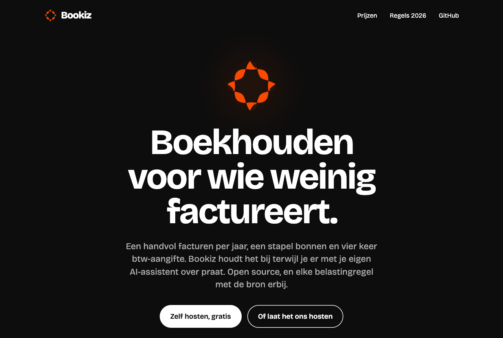

<p align="center">
  <a href="https://boekiehouder.nl">
    
  </a>
</p>

<h1 align="center">Bookiz</h1>

<p align="center">
  <strong>Bookkeeping for Dutch sole proprietors who send few invoices.</strong><br>
  You talk to the AI assistant you already use. Bookiz keeps the books, under tax rules you can read.
</p>

<p align="center">
  <a href="LICENSE"></a>
  <a href="rules/LICENSE"></a>
  
  
  
</p>

<p align="center">
  <a href="#quick-start">Quick start</a> ·
  <a href="#what-you-can-say">What you can say</a> ·
  <a href="#the-24-tools">Tools</a> ·
  <a href="#the-rules-are-data">Rules</a> ·
  <a href="#hosting">Hosting</a> ·
  <a href="https://boekiehouder.nl">Website (NL)</a>
</p>

<p align="center">
  
</p>

> **Nederlands, kort:** Bookiz is open-source boekhouding voor eenmanszaken met
> weinig facturen. Je regelt facturen, bonnen en je btw-aangifte door met je
> eigen AI-assistent te praten. Elke belastingregel staat in deze repository,
> met de pagina van de Belastingdienst waar hij vandaan komt.

## Why this exists

If you run a one-person service business in the Netherlands, your whole
administration is a handful of invoices, a pile of receipts and four btw
returns a year. Bookkeeping software is built and priced for businesses ten
times that size. And every spring you pay someone a few hundred euros because
you no longer trust your own numbers.

Bookiz is the opposite bet:

- **Small on purpose.** No bank feeds, no quotes, no stock, no payroll. One
  small database and 24 tools.
- **No app to learn.** It is an [MCP](https://modelcontextprotocol.io) server.
  Your assistant is the interface: Claude, Codex, or any other that lets you
  add your own MCP server.
- **No AI inside.** The assistant reads the receipt and supplies facts. A
  deterministic engine applies the rules. Same input, same books.
- **Rules you can check.** Every figure is in [`rules/nl-2026.json`](rules/nl-2026.json)
  with its official source and the sentence that states it. Your bookkeeper can
  read along.
- **Yours to leave.** Self-host it for free, export everything as one file.

> **Status: 0.1, early.** The engine is tested but has run no real
> administration yet. It calculates; it does not file with the Belastingdienst
> and it is not tax advice. Rules are complete for **2026**; 2027 is open for
> booking on provisional rules until the Belastingdienst publishes the rest.

## What you can say

```text
You     Richt mijn administratie in. Ik ben Studio Voorbeeld, KvK 12345678.

You     Maak een factuur voor Klant BV: tien uur advies à 85 euro.
Bookiz  Concept: € 850,00 + € 178,50 btw = € 1.028,50. Akkoord?
You     Ja.
Bookiz  Factuur 2026-001 is definitief. Zal ik hem versturen?

You     [photo of a receipt] Lunch met de klant, zelf voorgeschoten.
Bookiz  Geboekt als K2026-003: € 54,50, privé betaald. De btw op eten en
        drinken in de horeca is niet aftrekbaar; 80% telt als kosten.

You     Hoe sta ik ervoor?
Bookiz  Btw vierde kwartaal: € 157 te betalen, vóór 31 januari.
        Eén factuur staat open. Winst dit jaar: € 606,40.
```

Your assistant writes the sentences; the numbers and the tax treatment come
from Bookiz.

## What it does

| | |
| --- | --- |
| **Invoices** | Every legally required field, consecutive numbers, PDF, e-mail. A final invoice is never edited, only reversed by a credit invoice. |
| **Expenses** | Receipts and purchase invoices, also when paid privately. Reverse-charged foreign subscriptions (rubriek 4a/4b), investments with depreciation, kilometres with your own car. |
| **Btw-aangifte** | Monthly, quarterly or yearly (when the Belastingdienst allows it), per rubriek in whole euros, with the documents behind every number, the ICP list and the deadline. You copy the figures into Mijn Belastingdienst Zakelijk. |
| **KOR** | Invoices without btw, costs including btw, turnover tracked against the € 20.000 limit. The invoice that would cross it is refused. |
| **Year report** | Profit, kleinschaligheidsinvesteringsaftrek, zelfstandigenaftrek, startersaftrek, MKB-winstvrijstelling, and what to set aside for income tax and Zvw, also next to a job. |
| **Receipts** | The original goes to your own mailbox or a folder. The database keeps a SHA-256 hash, not the file. |
| **Recurring invoices** | A monthly, quarterly or yearly invoice becomes a draft on its date. Nothing is final without you. |
| **Switching** | Coming from Moneybird, another package or a spreadsheet: take over your customers, unpaid invoices, assets and invoice numbering. Old years stay in your export. |
| **Export** | A whole year as one JSON file, for your bookkeeper or for leaving. |

## Quick start

Local, on your own computer, with nothing to install but Node.js 22.18 or newer:

```bash
git clone https://github.com/meestierolff/bookiz.git
cd bookiz
npm install
```

Add it to your assistant as a local MCP server.

**Claude Code**

```bash
claude mcp add bookiz -- node /absolute/path/to/bookiz/src/cli.ts
```

**Claude Desktop** (`claude_desktop_config.json`)

```json
{
  "mcpServers": {
    "bookiz": { "command": "node", "args": ["/absolute/path/to/bookiz/src/cli.ts"] }
  }
}
```

Then say: *“Richt mijn administratie in.”*

Your data lives in `~/.bookiz`: an embedded Postgres, your receipts and your
invoice PDFs. Back that folder up. The embedded database serves one process at
a time; a second assistant on the same folder is refused with a clear message
instead of corrupting your books. To use several assistants at once, run the
[remote server](#remote-server).

## The 24 tools

| Tool | What it does |
| --- | --- |
| `get_overview` | Where you stand: open btw periods and deadlines, unpaid invoices, missing receipts, profit, what to set aside, next actions |
| `setup_business` | Business profile: name, address, KvK, btw-id, IBAN, KOR period, filing frequency |
| `set_year_facts` | Urencriterium, startersaftrek and wage income for a year |
| `save_contact` · `find_contacts` | Customers |
| `create_invoice` | A draft invoice, with totals and the remarks the law requires |
| `finalize_invoice` | Number it, lock it, make the PDF |
| `send_invoice` | E-mail the PDF to the customer, copy to you |
| `register_payment` | Mark an invoice paid |
| `credit_invoice` | Reverse a final invoice |
| `list_invoices` | By year or status |
| `save_recurring_invoice` · `list_recurring_invoices` | Invoices that repeat every 1, 3 or 12 months |
| `import_opening_state` | Switch from another package: numbering, unpaid invoices, assets |
| `record_expense` | Book a receipt or purchase invoice |
| `record_mileage` | Business kilometres with your own car |
| `attach_receipt` | Archive the original document |
| `void_expense` | Cancel a mistaken expense |
| `list_expenses` | By year, or only those without a receipt |
| `vat_return` | The btw-aangifte for a period, per rubriek |
| `mark_vat_return_filed` | Freeze a period after you filed it |
| `year_report` | From turnover to taxable profit, plus the tax indication |
| `export_books` | Everything for one year |
| `get_tax_rules` | The figures in use, with source and quote |

Every change is written to an audit log. Mistakes are corrected with a new
document, never by editing an old one.

## The rules are data

```json
"zelfstandigenaftrek": {
  "title": "Zelfstandigenaftrek",
  "value": 1200,
  "unit": "EUR",
  "source": "https://www.belastingdienst.nl/…/zelfstandigenaftrek-2026",
  "quote": "Dan is de zelfstandigenaftrek in 2026 een bedrag van € 1.200."
}
```

[`rules/nl-2026.json`](rules/nl-2026.json) holds all 21 rules the engine uses:
btw rates, the KOR limit, the KIA table, income tax brackets, heffingskortingen
and more. The engine refuses to calculate for a year without a rule file; it
never extrapolates.

Found a wrong figure? Open an issue or a pull request against the rule file.
See [rules/README.md](rules/README.md). The rules are MIT-licensed so anyone can
reuse them.

## Receipts: from your phone to the archive

An MCP tool receives text, not files, and assistants differ in what they pass on:

| Where you are | What happens |
| --- | --- |
| Local assistant (Claude Code, Claude Desktop, Codex) | The assistant passes the file path; Bookiz reads the file |
| ChatGPT with a remote server | `attach_receipt` declares `openai/fileParams`, so ChatGPT can hand over a download link to your upload |
| Any other assistant | The assistant reads the photo and books the expense; Bookiz returns a one-tap upload link for the original |

The last row always works. The ChatGPT route is built from OpenAI's
documentation and has not been tested against ChatGPT itself.

With `RECEIPT_ARCHIVE=email` the original is mailed with a fixed subject:
`[Bookiz bon] K2026-001 · date · vendor · amount`. Self-hosted, it goes to the
address you set as `archive_email` (or your business `email`). In Cloud it
always goes to the address you sign in with, the only one Bookiz has proof is
yours. You must keep receipts for seven years, so that mailbox is now part of
your administration.

## Hosting

| | Self-host | Cloud | Done for you |
| --- | --- | --- | --- |
| Price | Free | € 99 per year excl. btw, first 30 days free | € 399 per year excl. btw for the first 50, then € 499 |
| What | Everything in this repository | We host it; your assistant signs in with OAuth | Cloud, plus a bookkeeper who files your btw returns and income tax return |
| Available | Now | **Opening soon** | **Presale, not live yet** |

Details on [boekiehouder.nl](https://boekiehouder.nl/#prijzen). Switching per
1 January is explained step by step on
[boekiehouder.nl/overstappen](https://boekiehouder.nl/overstappen/).

### How Cloud is built

The hosted version is this same repository: `src/cloud/` plus one Vercel
function. Supabase provides Postgres, accounts and the OAuth server that
assistants sign in through. Every customer has a Postgres schema of their own;
the engine is pointed at one schema and cannot name another. `scripts/cloud-e2e.mjs`
checks the whole flow against a deployment, including that two customers see
nothing of each other.

### Remote server

For assistants that do not run on your computer:

```bash
export BOOKIZ_TOKEN=$(openssl rand -hex 24)
export PUBLIC_URL=https://bookiz.example.com
node src/cli.ts --http        # or: docker compose up -d
```

Put it behind HTTPS on port 443. Clients that can send a header (Claude Code,
Codex) use `https://bookiz.example.com/mcp` with `Authorization: Bearer <token>`.

claude.ai, ChatGPT and Grok only accept OAuth or an unauthenticated URL for
user-added servers. Until Bookiz has OAuth they can connect to
`https://bookiz.example.com/mcp/<url-secret>`, but only if you switch that on by
setting a second secret, `BOOKIZ_URL_TOKEN`. It is off by default.

**That URL is a password.** It can end up in logs and browser history, which is
why the MCP specification advises against secrets in URLs. So it is a separate
secret from `BOOKIZ_TOKEN`: you can rotate it without touching your other
clients, and it cannot be used to forge receipt or invoice links. If you use
it, turn off or redact access logging for `/mcp/*` on your reverse proxy.

| Variable | Purpose |
| --- | --- |
| `BOOKIZ_DATA_DIR` | Embedded database, receipts, PDFs. Default `~/.bookiz` |
| `DATABASE_URL` | Use this Postgres instead (Supabase, Neon, your own) |
| `BOOKIZ_TOKEN` | Required with `--http`, at least 24 characters. Sent as a Bearer header |
| `BOOKIZ_URL_TOKEN` | Optional second secret that enables `/mcp/<secret>` for URL-only assistants |
| `PUBLIC_URL` | Enables receipt-upload links and invoice PDF links |
| `SMTP_URL`, `MAIL_FROM` | Send invoices and archive receipts by e-mail (Brevo or any SMTP) |
| `RECEIPT_ARCHIVE` | `email` or `folder`. Default: `email` when SMTP is set |

On Supabase, use the session pooler connection string. Bookiz creates its
tables on first start and turns on row level security, so Supabase's
auto-generated web API cannot read them.

## Known limits

- **2027 is provisional.** The Belastingdienst had not published 2027 figures
  on 16 November 2026. Invoices, expenses and btw returns work in 2027 on the
  rules that carry no year; the kilometre rate, the year report and the tax
  estimate for 2027 wait for the published figures.
- **Switching is new** and was built from the rules, not from a real export of
  another package. Check the outstanding amount after importing.
- Invoice basis (factuurstelsel) only; no kasstelsel, no margin schemes, no
  goods across borders, no private-use corrections (rubriek 1d).
- The 80% rule is always used for limited-deductible costs, never the threshold.
- The tax estimate covers box 1, heffingskortingen and Zvw for one person below
  AOW age. No partner, mortgage, box 3 or allowances.
- No balance sheet: Bookiz does not know your bank balance.
- The KOR is one period (`kor_since` to `kor_until`); leaving and joining again
  later is not supported. The filing frequency (month or quarter) cannot change
  once expenses or returns exist.
- A btw period that has been filed cannot be reopened. Corrections go through
  the next return or a suppletie, outside Bookiz.
- Tested against the MCP SDK client over stdio and HTTP, on embedded and real
  Postgres. Not yet tested against the real claude.ai, ChatGPT and Grok apps.

## Development

```bash
npm run verify      # typecheck, rule-file check, tests, site build
npm test            # tests only, against an in-memory Postgres
npm run web:build   # static site into web/dist; prices and links in web/site.json
```

Built with heavy use of AI coding assistants, and reviewed and tested as such:
the tax examples in the tests are calculated by hand against the published
tables, and every figure has to carry its source. If you find a wrong number,
that is the most valuable issue you can open.

## License

Engine: [AGPL-3.0](LICENSE). Tax rules in `/rules`: [MIT](rules/LICENSE).
"Bookiz" is a name of its maintainers; a fork needs its own.
